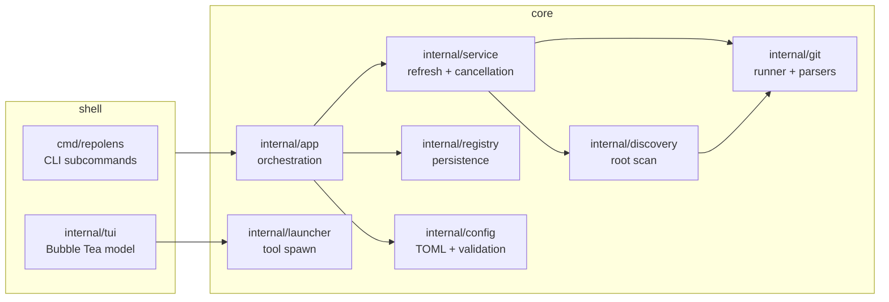

# RepoLens — Design Summary

Condensed design distilled from the full spec ([docs/repolens-spec.md](docs/repolens-spec.md)). Package-level detail lives in [docs/ARCHITECTURE.md](docs/ARCHITECTURE.md).

## What it is

A read-only, local-first TUI dashboard that answers "which of my many repos need attention?" It discovers Git working trees under registered roots, collects per-repo status with the real `git` binary, and presents a sortable, filterable table with drill-down detail. Launch actions hand off to the user's editor, terminal, file manager, Git TUI, or existing worktree manager.

## What it is not

Not a Git porcelain (no stage/commit/fetch/pull/push), not a worktree lifecycle manager (displays worktrees, launches the user's manager), not a daemon, not a cloud service. The MVP is strictly offline and read-only.

## Architecture

Data flow: `service` fans out bounded, cancellable Git calls per repo → results stream back as `repository.Status` values → TUI renders rows as they arrive. One repo's error is status data, not a crash. Registry/cache writes are atomic; cache entries carry a staleness flag.

## Key decisions

| Decision | Choice | Why |
|---|---|---|
| Git integration | Git CLI subprocesses, arg arrays | Honors installed Git semantics; handles worktrees/submodules; no re-implementation |
| Git output | `porcelain` versioned, NUL-delimited | Machine-parseable; survives spaces/newlines/unicode in filenames |
| TUI | Bubble Tea + Bubbles + Lip Gloss | Standard Go TUI stack; model/update/view is testable |
| Config | TOML at XDG paths | Human-editable; no server |
| Fuzzy search | In-process | `fzf` must not be a dependency |
| Registry | Local file, atomic writes | A DB is unjustified for path+preference storage |
| Concurrency | Bounded Git subprocess pool, per-command timeout, cancellable scans | UI responsiveness over scan throughput |
| Network | None | Local refs only; "stale" is displayed, never silently fetched away |

## Safety invariants

1. No command that mutates a repository is ever issued (see `AGENTS.md` for the allowed verb list).
2. Repo-derived strings are sanitized before terminal rendering (escape-sequence injection).
3. External tools launch via executable + arg array with an explicit `{path}` placeholder — no shell, ever.
4. Nothing fetches, hooks fire, or scripts execute automatically.
5. A missing/git-erroring repo shows an error state; the dashboard keeps working.

## Phases

Phase 0 foundation → Phase 1 Git status engine → Phase 2 registry + discovery → Phase 3 dashboard TUI → Phase 4 detail/navigation → Phase 5 CLI + Fish → Phase 6 packaging. Each phase has exit criteria in the spec (§21).
