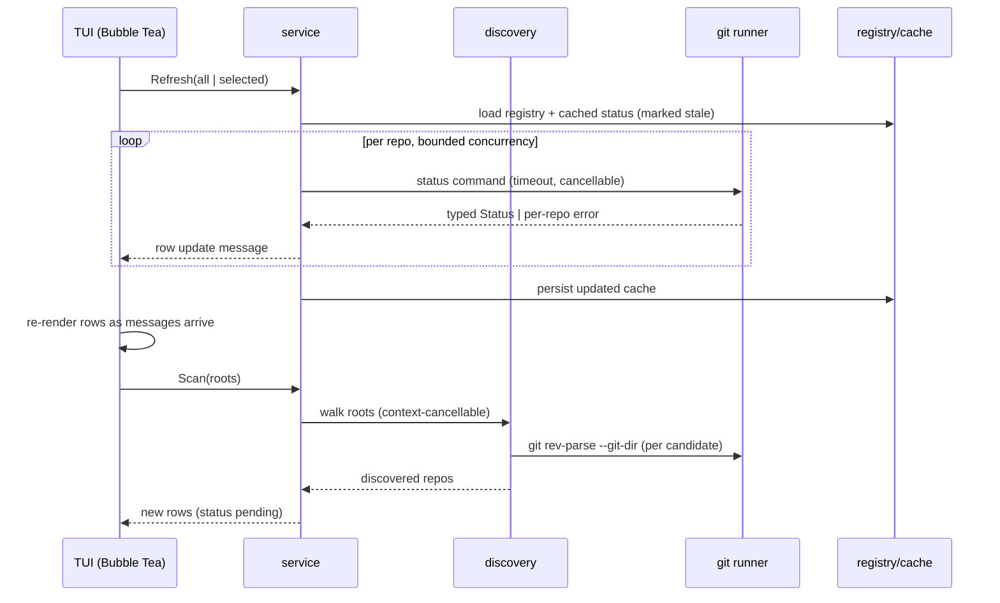

# Architecture

Package responsibilities and data flow. For product context see [DESIGN.md](../DESIGN.md); for requirements see [repolens-spec.md](repolens-spec.md).

## Package map

```
cmd/repolens/         Entry point. Parses CLI flags/subcommands, wires config, runs TUI or one-shot command.
internal/app/         Application lifecycle: load config → load registry → start service → run TUI/CLI.
internal/config/      TOML schema, XDG path resolution, `~`/env expansion, validation with key-level errors.
                      The only package that reads config files.
internal/discovery/   Walks registered roots (depth limit, exclude patterns, no symlink following by default),
                      detects working trees via `git rev-parse --git-dir`, dedupes physical trees, detects
                      linked worktrees. Cancellable via context.
internal/git/         Command runner: arg arrays only, per-command timeout, concurrency semaphore.
                      Parsers for porcelain status, branch/upstream, ahead/behind (rev-list), log, diff.
                      The only package that spawns `git`.
internal/repository/  Domain types: Status enum, change counts, upstream info, attention rules, sort/filter.
internal/registry/    Registered paths + per-repo prefs + UI state. Atomic writes (tmp + rename),
                      backup + recovery on corruption.
internal/cache/       Status cache. Every entry carries a timestamp + stale flag; freshness is explicit.
internal/service/     Refresh orchestration: schedules per-repo git calls, enforces no duplicate scans,
                      supports targeted + full refresh, cancels stale work. Aggregates header counts.
internal/tui/         Bubble Tea model/update/view. Renders rows as results arrive; preserves selection
                      across refreshes; adapts columns to terminal width. components/ for list, detail,
                      diff viewport, help overlay, search input.
internal/launcher/    Spawn editor/terminal/file-manager/Git-TUI/worktree-manager via executable + arg
                      array with `{path}` substitution. Validates executables; never uses a shell.
internal/logging/     `slog` setup, debug mode, log file under XDG state dir.
```

## Data flow



## Data stores

| Path | Contents |
|---|---|
| `${XDG_CONFIG_HOME}/repolens/config.toml` | User config (roots, excludes, commands, display, keymap) |
| `${XDG_DATA_HOME}/repolens/registry.*` | Registered repo paths, tags, per-repo prefs, last selection, UI prefs |
| `${XDG_CACHE_HOME}/repolens/status.*` | Cached status snapshots, always flagged with timestamp/freshness |
| `${XDG_STATE_HOME}/repolens/` | Log files |

## Invariants

- `internal/git` is the sole subprocess owner; `internal/config` the sole config parser; `internal/registry` the sole state writer.
- Ahead/behind is computed against local tracking refs via `git rev-list --left-right --count`; `nil` upstream is rendered as "no upstream", missing data as "unknown" — never 0/0.
- A repository that disappears is marked unavailable in the UI, not removed from the registry.
- Scans dedupe by resolved working-tree path; linked worktrees are separate entries sharing a common git dir.
